<div align="center">


<br/>

<a href="https://brunosuassuna.github.io/"></a>
<a href="https://www.linkedin.com/in/bruno-suassuna-698aa7235"></a>
<a href="mailto:brunosuassuna.dev@gmail.com"></a>
<a href="https://github.com/brunosuassuna?tab=repositories"></a>

<br/>

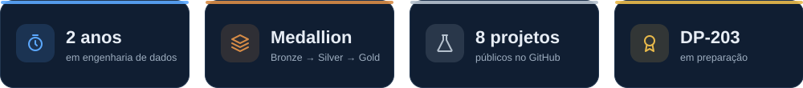

</div>

<br/>

<div align="center"></div>

<br/>

| Resumo | |
|:--|:--|
| **Cargo** | Engenheiro de Dados, 2 anos de experiência |
| **No dia a dia** | Azure Data Factory · Databricks · **Snowflake** · Azure DevOps · Power BI · Python · SQL · PySpark · Delta Lake |
| **Especialidade** | Lakehouse com arquitetura Medallion (Bronze → Silver → Gold) |
| **Local** | João Pessoa, PB |
| **Idiomas** | Português (nativo) · Espanhol (avançado) |
| **Formação** | Pós em Ciência de Dados e Analytics (PUC-Rio) · Análise e Desenvolvimento de Sistemas (Unipê) |
| **Agora** | Preparando a certificação **Azure DP-203** |

<details>
<summary><b>English version</b></summary>

<br/>

**Data Engineer, 2 years of experience**, based in Brazil. I build cloud data pipelines on **Azure**, **Databricks** and **Snowflake**, using a **Medallion lakehouse** approach with Delta Lake and PySpark. Day to day: Azure Data Factory, Azure DevOps and Power BI. Currently preparing for the **Azure Data Engineer Associate (DP-203)**.

**Languages:** Portuguese (native) · Spanish (advanced)

</details>

<br/>

<div align="center"></div>

<div align="center">

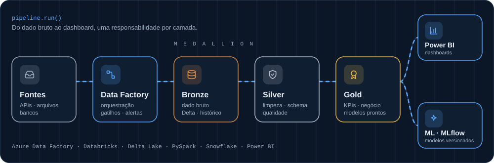

</div>

Cada camada tem uma responsabilidade clara. Abra uma delas para ver o que acontece ali e um exemplo em PySpark.

<details>
<summary><b>Bronze</b> · o dado bruto, do jeito que chegou</summary>

<br/>

| Item | Detalhes |
|:--|:--|
| **O que faz** | Guarda o dado original em Delta, com data e arquivo de origem. Nada é descartado, então dá para reprocessar. |
| **Ferramentas** | Databricks · Delta Lake · PySpark |

```python
from pyspark.sql import functions as F

raw = spark.read.format("json").load("abfss://raw@<storage>.dfs.core.windows.net/pedidos/")

(raw.withColumn("_ingested_at", F.current_timestamp())
    .withColumn("_source_file", F.col("_metadata.file_path"))
    .write.format("delta").mode("append")
    .saveAsTable("bronze.pedidos"))
```

</details>

<details>
<summary><b>Silver</b> · o dado limpo e confiável</summary>

<br/>

| Item | Detalhes |
|:--|:--|
| **O que faz** | Remove duplicados, corrige tipos, filtra registros inválidos e valida o schema. |
| **Ferramentas** | Databricks · Delta Lake · PySpark |

```python
bronze = spark.read.table("bronze.pedidos")

silver = (bronze
    .dropDuplicates(["pedido_id"])
    .withColumn("valor", F.col("valor").cast("decimal(12,2)"))
    .withColumn("data_pedido", F.to_date("data_pedido"))
    .filter(F.col("valor") > 0))

silver.write.format("delta").mode("overwrite").saveAsTable("silver.pedidos")
```

</details>

<details>
<summary><b>Gold</b> · tabelas prontas para o negócio</summary>

<br/>

| Item | Detalhes |
|:--|:--|
| **O que faz** | Métricas e KPIs calculados uma vez e usados por todo mundo, em tabelas simples para BI. |
| **Ferramentas** | Delta Lake · SQL · PySpark · Power BI |

```python
gold = (spark.read.table("silver.pedidos")
    .groupBy("data_pedido", "canal")
    .agg(F.sum("valor").alias("receita"),
         F.countDistinct("pedido_id").alias("pedidos")))

gold.write.format("delta").mode("overwrite").saveAsTable("gold.receita_diaria")
```

</details>

> Quer ver rodando? No [portfólio](https://brunosuassuna.github.io/) tem uma demo em que um pequeno conjunto de pedidos passa por Bronze, Silver e Gold direto no navegador.

<br/>

<div align="center"></div>

<div align="center">

<a href="https://github.com/brunosuassuna/MVP-Engenharia-de-Dados">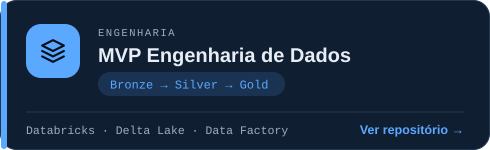</a>
<a href="https://github.com/brunosuassuna/Analise-de-Corridas-de-Taxi-em-NYC">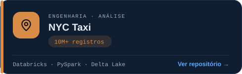</a>
<a href="https://github.com/brunosuassuna/Analise-de-Vendas">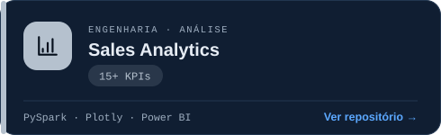</a>
<a href="https://github.com/brunosuassuna/Analise-Qualidade-de-Vinhos">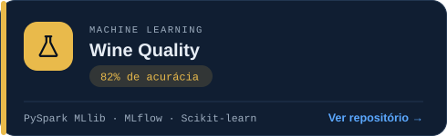</a>
<a href="https://github.com/brunosuassuna/API_Gerenciamento_Usuarios">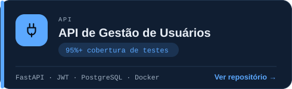</a>
<a href="https://github.com/brunosuassuna/Analise-Temporal-de-Passageiros-Aereos">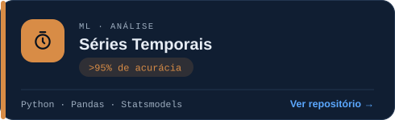</a>
<a href="https://github.com/brunosuassuna/COVID-19-Global-Data-Analysis">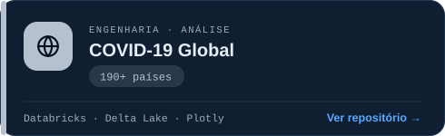</a>
<a href="https://github.com/brunosuassuna/premier-league-analysis">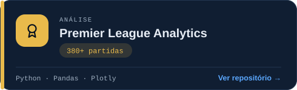</a>

</div>

<details>
<summary><b>Problema, o que construí e stack de cada projeto</b></summary>

<br/>

| Projeto | Problema | O que construí |
|:--|:--|:--|
| **MVP Engenharia de Dados** | Estruturar dados brutos em um fluxo confiável e reutilizável | Pipeline Medallion no Databricks, com orquestração automatizada, schema enforcement e checagens de qualidade |
| **NYC Taxi** | Extrair padrões de demanda de um grande volume de corridas | Processamento distribuído de 10M+ registros, análise geoespacial e demanda por horário |
| **Sales Analytics** | Consolidar vendas em indicadores que a gestão acompanha | ETL automatizado alimentando 15+ KPIs (receita, churn, LTV, conversão) em dashboards |
| **Wine Quality** | Classificar a qualidade de vinhos por características físico-químicas | Random Forest, GBT e Regressão Logística com PySpark MLlib, rastreados no MLflow (82% de acurácia) |
| **API de Gestão de Usuários** | Gestão de usuários com autenticação segura | API REST com FastAPI, JWT, CRUD, validação e PostgreSQL, pronta para Docker (95%+ de cobertura de testes) |
| **Séries Temporais** | Prever a demanda de passageiros aéreos | ARIMA/SARIMA, decomposição e testes de estacionariedade (>95% de acurácia nas previsões) |
| **COVID-19 Global** | Acompanhar o impacto global da pandemia | Delta Lake versionado para casos, óbitos e vacinação, 190+ países |
| **Premier League Analytics** | Entender o desempenho da temporada 2023/24 | Dashboard com mais de 100 métricas por time e jogador, incluindo xG vs posição final (380+ partidas) |

</details>

<br/>

<div align="center"></div>

<div align="center">

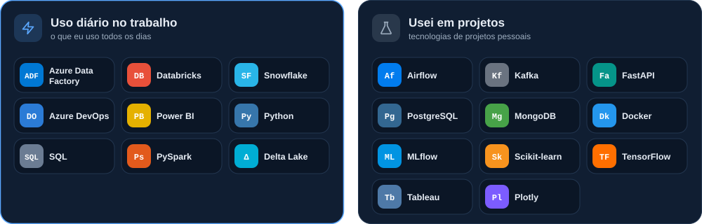

</div>

<br/>

<div align="center"></div>

<br/>

| Formação | Instituição |
|:--|:--|
| Pós-graduação em Ciência de Dados e Analytics | PUC-Rio |
| Análise e Desenvolvimento de Sistemas | Unipê |
| **Microsoft Azure Data Engineer Associate (DP-203)** | Em preparação |

<details>
<summary><b>Cursos concluídos</b></summary>

<br/>

- [Databricks e Azure Data Factory](https://www.alura.com.br/certificados/f7f1b321-c941-400f-9e69-b0884846dddd), Alura
- [Fundamentos de Engenharia de Dados](https://www.datascienceacademy.com.br/certificados/6400288ed95562f1e20b5169), Data Science Academy
- [Formação Data Science](https://www.alura.com.br/certificados/5b4e3bf7-0adf-4a17-8aa7-6455fe7cdee1), Alura
- [Data Science: Regressão Linear](https://www.alura.com.br/certificados/616d92b5-d324-4b61-937c-e90d710cf3a0), Alura
- [Governança de Dados: Conceitos Fundamentais](https://www.alura.com.br/certificados/2dcf795f-f659-4eae-b4d3-1824b8575e0c), Alura

</details>

<br/>

<div align="center">


<br/>

<picture>
  <source media="(prefers-color-scheme: dark)" srcset="https://raw.githubusercontent.com/brunosuassuna/brunosuassuna/output/github-snake-dark.svg"/>
  <source media="(prefers-color-scheme: light)" srcset="https://raw.githubusercontent.com/brunosuassuna/brunosuassuna/output/github-snake.svg"/>
  
</picture>

</div>

<br/>

<div align="center"></div>

<div align="center">

<br/>

Gosto de trocar ideias sobre **engenharia de dados, Azure, Databricks, Snowflake e PySpark**. Fique à vontade para me chamar.

<br/>

<a href="https://www.linkedin.com/in/bruno-suassuna-698aa7235"></a>
<a href="mailto:brunosuassuna.dev@gmail.com"></a>
<a href="https://brunosuassuna.github.io/"></a>

</div>
