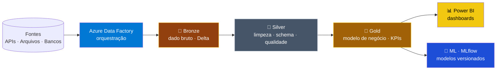

<div align="center">


<a href="https://brunosuassuna.github.io/">
  
</a>

<br/>

[](https://brunosuassuna.github.io/)
[](https://www.linkedin.com/in/bruno-suassuna-698aa7235)
[](mailto:brunosuassuna.dev@gmail.com)
[](https://github.com/brunosuassuna?tab=repositories)


</div>

---

## ⚡ Em 30 segundos

| | |
|:--|:--|
| 🎯 **Cargo** | Engenheiro de Dados · 2 anos de experiência |
| ☁️ **Stack principal** | Azure Data Factory · Databricks · Snowflake · PySpark · Delta Lake · Azure DevOps · Power BI |
| 🏗️ **Especialidade** | Arquitetura Medallion (Bronze → Silver → Gold) em lakehouse |
| 📍 **Local** | João Pessoa, PB |
| 🌎 **Idiomas** | 🇧🇷 Português (nativo) · 🇪🇸 Espanhol (avançado) · 🇺🇸 Inglês (<!-- ajuste seu nível -->) |
| 🎓 **Formação** | Pós em Ciência de Dados e Analytics (PUC-Rio) · Análise e Desenvolvimento de Sistemas (Unipê) |
| 🔄 **Agora** | Preparando a certificação **Azure DP-203** |

<details>
<summary><b>🇺🇸 Click for the English version</b></summary>

<br/>

**Data Engineer, 2 years of experience**, based in Brazil. I build cloud data pipelines on **Azure**, **Databricks** and **PySpark** using a **Medallion lakehouse** approach with Delta Lake. Day to day: Azure Data Factory, Snowflake, Azure DevOps and Power BI. Currently preparing for the **Azure Data Engineer Associate (DP-203)**.

**Languages:** Portuguese (native) · Spanish (advanced) · English (<!-- adjust your level -->)

</details>

---

## 🏗️ Como eu construo pipelines

Visão geral da arquitetura que uso nos meus projetos. Clique nas caixas para ver os repositórios.



---

## 🚀 Projetos em destaque

Cards ao vivo, com dados atualizados direto do GitHub. Clique para abrir o repositório.

<div align="center">

<a href="https://github.com/brunosuassuna/MVP-Engenharia-de-Dados">
  
</a>
<a href="https://github.com/brunosuassuna/Analise-de-Corridas-de-Taxi-em-NYC">
  
</a>
<a href="https://github.com/brunosuassuna/Analise-de-Vendas">
  
</a>
<a href="https://github.com/brunosuassuna/Analise-Qualidade-de-Vinhos">
  
</a>

</div>

<details>
<summary><b>🏗️ MVP Engenharia de Dados</b> · Medallion completo no Databricks</summary>

<br/>

- **Problema:** estruturar dados brutos em um fluxo confiável e reutilizável.
- **O que fiz:** pipeline Bronze → Silver → Gold com orquestração automatizada, schema enforcement e checagens de qualidade.
- **Stack:** `Databricks` `Delta Lake` `Azure Data Factory` `PySpark`
- [➡️ Ver repositório](https://github.com/brunosuassuna/MVP-Engenharia-de-Dados)

</details>

<details>
<summary><b>🚖 NYC Taxi</b> · 10M+ registros com PySpark</summary>

<br/>

- **Problema:** extrair padrões de demanda de um grande volume de corridas.
- **O que fiz:** processamento distribuído de **10M+ registros** no Databricks, análise geoespacial e modelagem de demanda por horário.
- **Stack:** `Databricks` `PySpark` `Delta Lake`
- [➡️ Ver repositório](https://github.com/brunosuassuna/Analise-de-Corridas-de-Taxi-em-NYC)

</details>

<details>
<summary><b>📊 Sales Analytics</b> · ETL + 15 KPIs executivos</summary>

<br/>

- **Problema:** consolidar vendas em indicadores acompanháveis pela gestão.
- **O que fiz:** ETL automatizado alimentando **15+ KPIs** (receita, churn, LTV, conversão) em dashboards interativos.
- **Stack:** `PySpark` `Plotly` `Power BI`
- [➡️ Ver repositório](https://github.com/brunosuassuna/Analise-de-Vendas)

</details>

<details>
<summary><b>🍷 Wine Quality</b> · ML com MLflow tracking (82% de acurácia)</summary>

<br/>

- **Problema:** classificar a qualidade de vinhos a partir de características físico-químicas.
- **O que fiz:** feature engineering e comparação de Random Forest, GBT e Regressão Logística com PySpark MLlib, rastreados no MLflow.
- **Resultado:** **82% de acurácia** no melhor modelo.
- [➡️ Ver repositório](https://github.com/brunosuassuna/Analise-Qualidade-de-Vinhos)

</details>

<details>
<summary><b>🔐 API de Gestão de Usuários</b> · FastAPI + JWT (95%+ de testes)</summary>

<br/>

- **O que fiz:** API REST com autenticação JWT, CRUD completo, validação de entrada e PostgreSQL, pronta para Docker.
- **Resultado:** **95%+ de cobertura de testes**.
- [➡️ Ver repositório](https://github.com/brunosuassuna/API_Gerenciamento_Usuarios)

</details>

<details>
<summary><b>📈 Projetos de análise</b> · séries temporais, COVID-19, Premier League</summary>

<br/>

- ✈️ [Séries temporais de passageiros aéreos](https://github.com/brunosuassuna/Analise-Temporal-de-Passageiros-Aereos): ARIMA/SARIMA, decomposição e testes de estacionariedade (>95% de acurácia nas previsões)
- 🦠 [COVID-19 Global Analysis](https://github.com/brunosuassuna/COVID-19-Global-Data-Analysis): Delta Lake versionado, 190+ países
- ⚽ [Premier League Analytics](https://github.com/brunosuassuna/premier-league-analysis): 380+ partidas da temporada 2023/24, xG vs posição final

</details>

<!--
RESULTADOS PROFISSIONAIS: preencha só com números que você consegue comprovar.
Formato: "Reduzi o tempo da pipeline X de A para B trocando ... por ..."
-->

---

## 🛠️ Stack

<div align="center">


<br/><br/>


</div>

<details>
<summary><b>Uso diário vs. usei em projetos</b></summary>

<br/>

| Nível | Tecnologias |
|:--|:--|
| **Uso diário no trabalho** | Azure Data Factory, Databricks, Snowflake, Azure DevOps, Power BI, Python, SQL, PySpark, Delta Lake |
| **Usei em projetos** | Airflow, Kafka, FastAPI, PostgreSQL, MongoDB, Docker, MLflow, Scikit-learn, TensorFlow, Tableau, Plotly |

</details>

---

## 🎓 Certificações

- 🔄 **Microsoft Azure Data Engineer Associate (DP-203)**: em preparação

<details>
<summary><b>Cursos concluídos</b></summary>

<br/>

- [Databricks e Azure Data Factory](https://www.alura.com.br/certificados/f7f1b321-c941-400f-9e69-b0884846dddd), Alura
- [Fundamentos de Engenharia de Dados](https://www.datascienceacademy.com.br/certificados/6400288ed95562f1e20b5169), Data Science Academy
- [Formação Data Science](https://www.alura.com.br/certificados/5b4e3bf7-0adf-4a17-8aa7-6455fe7cdee1), Alura
- [Data Science: Regressão Linear](https://www.alura.com.br/certificados/616d92b5-d324-4b61-937c-e90d710cf3a0), Alura
- [Governança de Dados: Conceitos Fundamentais](https://www.alura.com.br/certificados/2dcf795f-f659-4eae-b4d3-1824b8575e0c), Alura

</details>

---

## 📚 Foco atual

```text
[x] Pipelines Medallion no Databricks
[x] Orquestração com Azure Data Factory
[~] Certificação DP-203 (em andamento)
[~] Qualidade de dados e testes em pipelines
[ ] CI/CD de pipelines com Azure DevOps
[ ] Streaming com Kafka e Spark Structured Streaming
```

---

## 📊 Atividade no GitHub

<div align="center">


<br/>


<br/>

<picture>
  <source media="(prefers-color-scheme: dark)" srcset="https://raw.githubusercontent.com/brunosuassuna/brunosuassuna/output/github-snake-dark.svg"/>
  <source media="(prefers-color-scheme: light)" srcset="https://raw.githubusercontent.com/brunosuassuna/brunosuassuna/output/github-snake.svg"/>
  
</picture>

</div>

---

## 📬 Vamos conversar?

<div align="center">

Gosto de trocar ideias sobre **engenharia de dados, Azure, Databricks e PySpark**. Fique à vontade para me chamar.
<br/>
*Always happy to talk about data engineering, Azure, Databricks and PySpark.*

<br/>

<a href="https://www.linkedin.com/in/bruno-suassuna-698aa7235"></a>
<a href="mailto:brunosuassuna.dev@gmail.com"></a>
<a href="https://brunosuassuna.github.io/"></a>

<br/><br/>


</div>
